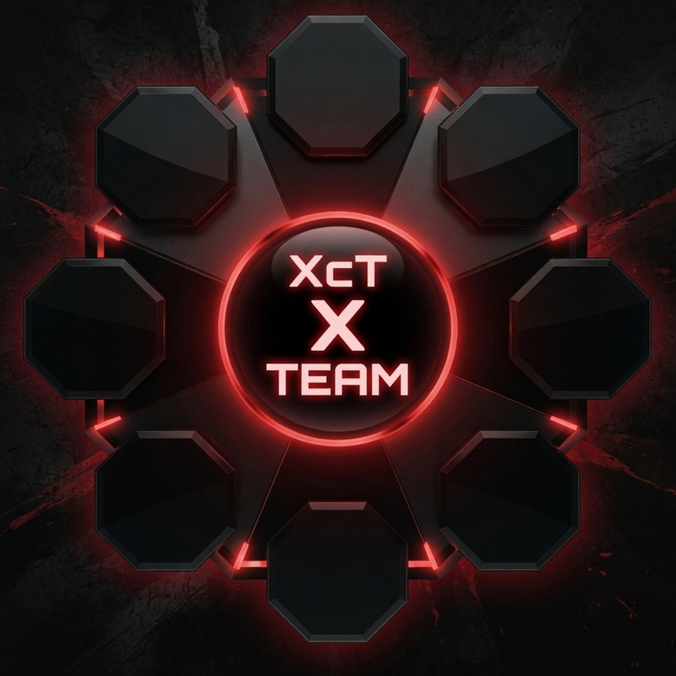

# 👕 Outfit Ziko — Free Fire Outfit Image API

> **ولّد صورة أوتفيت لاعب فري فاير في ثوانٍ — بمجرد الـ UID.**

[English below](#english)

## ✨ ما هذا المشروع؟

**Outfit Ziko** هو API سريع مبني بـ **FastAPI** يولّد صورة أوتفيت كاملة لأي لاعب Free Fire انطلاقًا من الـ UID فقط:

1. يجلب بيانات اللاعب من API خارجي.
2. يستخرج معرّفات عناصر الأوتفيت (الرأس، الوجه، الظهر، السفلي، العلوي، الحيوان الأليف، السلاح، الحركة…).
3. يجلب أيقونة كل عنصر ويضعها في مكانها على قالب داكن بأسلوب نيون أحمر.
4. يعيد صورة PNG جاهزة للمشاركة.



## 🚀 الاستخدام

### محليًا

```bash
pip install -r requirements.txt
python app.py
# يعمل على http://localhost:8000
```

### عبر الـ API

```
GET /ziko-outfit-image?key=ziko&uid=UID
```

| المعامل | الوصف |
|---|---|
| `uid` | معرّف اللاعب (UID) في Free Fire |
| `key` | مفتاح الـ API |

**مثال:**

```
https://<your-deployment>/ziko-outfit-image?key=ziko&uid=123456789
```

**نقاط النهاية:**

- `GET /` — رسالة ترحيبية وطريقة الاستخدام.
- `GET /ziko-outfit-image` — توليد صورة الأوتفيت (PNG).

## ⚡ لماذا هو سريع؟

- **طلبات متوازية:** جميع الأيقونات تُجلب في نفس الوقت (`asyncio.gather`).
- **تخزين مؤقت:** الأيقونات الناجحة تُحفظ 10 دقائق، والفاشلة 5 ثوانٍ فقط.
- **إعادة المحاولة:** حتى محاولتين لكل أيقونة قبل الاستسلام.
- **عناصر احتياطية:** إذا لم يُعثر على عنصر، يُستخدم معرّف افتراضي حتى لا تبقى الخانة فارغة.

## 🧩 التقنيات

- **FastAPI** — إطار الويب
- **Uvicorn** — خادم ASGI
- **httpx** — طلبات HTTP غير متزامنة
- **Pillow** — تركيب الصور
- **Vercel** — النشر (`@vercel/python`)

## 📁 بنية المشروع

```
Outfit-ziko/
├── app.py            # الـ API كاملًا (نقاط النهاية + تركيب الصورة)
├── outfit.png        # قالب الخلفية (861×862)
├── requirements.txt  # الاعتماديات
└── vercel.json       # إعداد النشر على Vercel
```

## 🔐 ملاحظة أمنية

مفتاح الـ API الحالي مفتاح تجريبي — يُنصح بنقله إلى متغير بيئة (`API_KEY`) وتغييره قبل أي نشر عام.

---

<a id="english"></a>

## English

**Outfit Ziko** is a fast FastAPI service that generates a complete Free Fire player outfit image from just a UID. It fetches the player's data, extracts the outfit item IDs, downloads each item icon in parallel, and composites them onto a dark red-neon template — returning a share-ready PNG.

**Usage:** `GET /ziko-outfit-image?key=ziko&uid=UID`

**Stack:** FastAPI · Uvicorn · httpx · Pillow · Vercel
